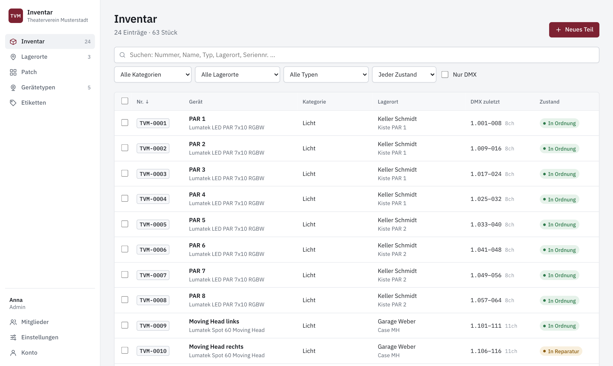
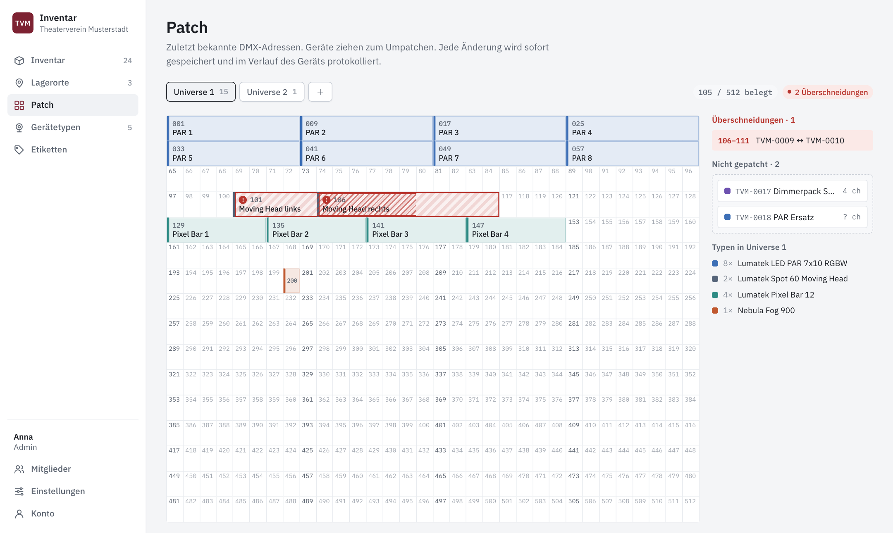
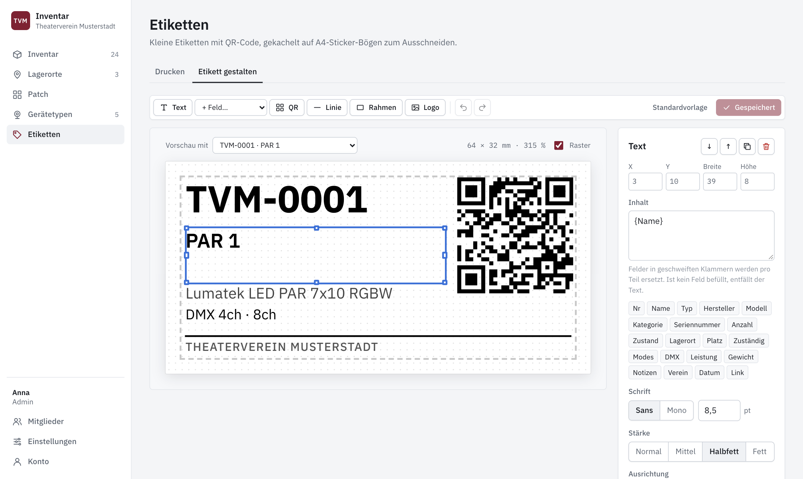
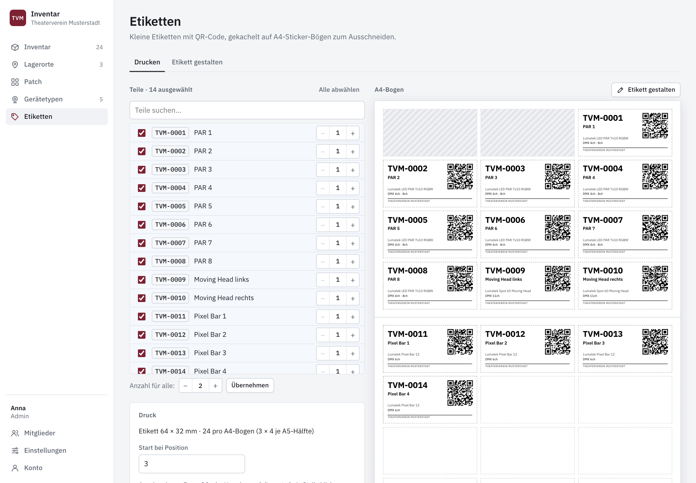

# Showtechnik-Inventar

Inventar für die Showtechnik eines Theater- oder Kulturvereins: Licht, Ton, Kabel und alles andere, verteilt auf
die Keller und Garagen der Mitglieder.



- **Inventar** mit automatischer Inventarnummer (`INV-0001`, …, Präfix einstellbar), Fotos, Zustand, Seriennummer, Suche und Filtern
- **Lagerorte** mit zuständiger Person und Platzangabe (Kiste, Regal, Case)
- **Gerätetypen** mit GDTF-Import (Modes, Kanäle und Kanalfunktionen werden ausgelesen, die Datei bleibt unverändert gespeichert), Anleitungen als PDF
- **Patch-Raster** wie in Daslight: 512 Kanäle pro Universe, Drag & Drop, Überschneidungen werden markiert, zuletzt bekannte Adresse mit Datum und Person
- **Etiketten** mit QR-Code, frei gestaltbar (WYSIWYG), gekachelt auf A4-Sticker-Bögen zum Ausschneiden
- **Änderungsverlauf** pro Teil, persönliche Konten, Löschen nur für Admins

| Patch-Raster | Etikett gestalten | Etiketten drucken |
|---|---|---|
|  |  |  |

<sub>Screenshots mit erfundenen Beispieldaten.</sub>

Stack: [PocketBase](https://pocketbase.io) 0.40.5 (SQLite, Auth, Dateien) und ein Frontend aus Preact/htm ohne Build-Schritt.
Alle Bibliotheken und Schriften liegen im Repo, es werden keine externen Dienste oder CDNs geladen.

```
pb_migrations/   Schema: Collections, Zugriffsregeln, Backup-Zeitplan
pb_hooks/        Serverlogik: Inventarnummer, DMX-Zeitstempel, Änderungsverlauf
pb_public/       Frontend: index.html, app.css, js/, vendor/ (Bibliotheken), fonts/ (IBM Plex)
licenses/        Lizenztexte der mitgelieferten Fremdkomponenten
docs/            Screenshots für diese README
```

## Lokal starten

Voraussetzung ist nur das PocketBase-Binary (wird nicht mitversioniert, landet in `bin/`).
Passende Datei für das eigene System von den [PocketBase-Releases v0.40.5](https://github.com/pocketbase/pocketbase/releases/tag/v0.40.5) laden, z. B. für macOS mit Apple Silicon:

```sh
curl -sL -o /tmp/pb.zip https://github.com/pocketbase/pocketbase/releases/download/v0.40.5/pocketbase_0.40.5_darwin_arm64.zip
unzip -o /tmp/pb.zip pocketbase -d bin

./bin/pocketbase superuser upsert admin@example.com '<passwort>' --dir=pb_data
./bin/pocketbase serve --dir=pb_data --hooksDir=pb_hooks --migrationsDir=pb_migrations --publicDir=pb_public
```

App: http://127.0.0.1:8090 · Admin-Dashboard: http://127.0.0.1:8090/_/

Die Migration legt beim ersten Start alle Collections an. Daten liegen in `pb_data/` (nicht im Repo).

## Konten

- **Superuser** (Dashboard `/_/`): für Einrichtung, Backups und Notfälle.
- **App-Konten** liegen in der Collection `users` mit `role` = `member` oder `admin`.
  Das erste Admin-Konto im Dashboard anlegen (users → New record, role = `admin`), danach legen Admins
  weitere Mitglieder direkt in der App unter **Mitglieder** an und können dort Passwörter setzen.
- Mitglieder dürfen alles anlegen und bearbeiten, löschen dürfen nur Admins.

## Betrieb mit Docker

`docker-compose.yml` baut ein schlankes Image mit dem PocketBase-Binary und bindet `pb_public`, `pb_hooks`,
`pb_migrations` und `pb_data` als Volumes ein. Die App lauscht auf `127.0.0.1:8088`. Davor gehört ein
Reverse Proxy mit HTTPS (z. B. Traefik, Caddy oder nginx), der auf diesen Port weiterleitet.

```sh
rsync -av --exclude bin --exclude pb_data ./ <server>:<pfad>/
ssh <server> 'cd <pfad> && docker compose up -d --build'
docker compose exec pocketbase /pb/pocketbase superuser upsert admin@example.com '<passwort>' --dir=/pb/pb_data
```

- Änderungen in `pb_public/` sind sofort live, Hooks werden automatisch neu geladen.
- Neue Migrationen laufen beim Neustart des Containers.
- Hinter einem Proxy ist `X-Forwarded-For` als vertrauenswürdiger Header für die Client-IP voreingestellt.

## Backups

PocketBase legt täglich um 03:30 ein Backup in `pb_data/backups/` an und behält die letzten 14.
Wiederherstellen über das Dashboard → Settings → Backups. `pb_data/` zusätzlich extern sichern.

## Etiketten

Kleine Etiketten (Standard 64 × 32 mm, frei einstellbar) werden auf A4-Sticker-Bögen gekachelt und ausgeschnitten.
Standardmäßig liegt kein Etikett über der Trennung der beiden A5-Sticker (Abstand und Rand einstellbar).
Startposition für angebrochene Bögen per Klick in der Bogen-Vorschau, Anzahl pro Teil frei wählbar.

Das Etikett wird in der App unter **Etiketten → Etikett gestalten** visuell bearbeitet: Text mit Feldern wie `{Nr}`,
`{Name}` oder `{Modes}`, QR-Code, Linien, Rahmen, Logo; Maße in mm, Schrift in pt. Die Vorlage gilt für alle
(`settings.label_template`, Logo in `settings.label_logo`). Ohne gespeicherte Vorlage gilt der Standard aus
`pb_public/js/labels.js`. Designer, Vorschau und Druck nutzen denselben Renderer.
Im Druckdialog Skalierung 100 % und Ränder „keine“ wählen.

## Einstellungen

Vereinsname, Kürzel für das Logo und das Präfix der Inventarnummern setzen Admins in der App unter
**Einstellungen**. Sie liegen in der Datenbank, nicht im Code. Der Vereinsname steht auf Etiketten als Feld `{Verein}`
zur Verfügung. Farben und Schrift lassen sich über die Tokens am Anfang von `pb_public/app.css` anpassen.

## Lizenz

MIT, siehe [`LICENSE`](LICENSE). Mitgelieferte Fremdkomponenten (htm, Preact, PocketBase JS SDK, uqr, IBM Plex)
stehen unter ihren eigenen Lizenzen, siehe [`THIRD_PARTY_LICENSES.md`](THIRD_PARTY_LICENSES.md).
